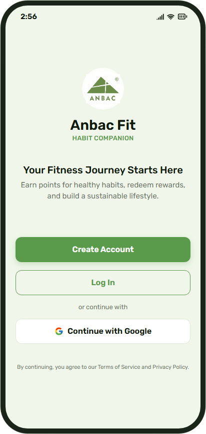
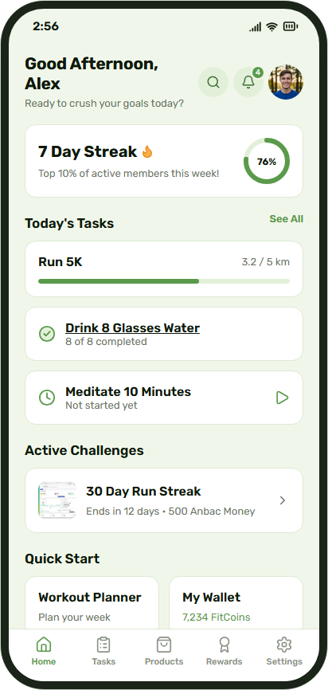
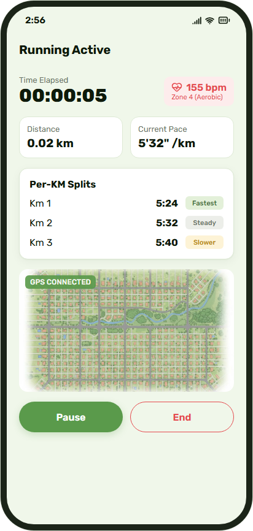
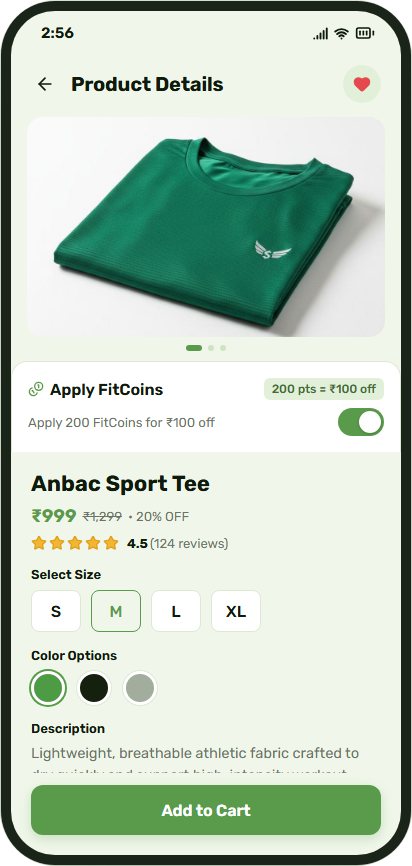
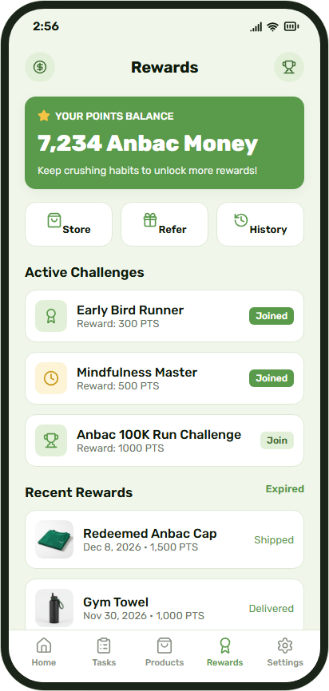
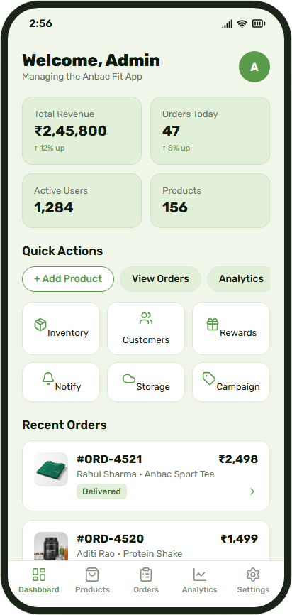

# Anbac Fit — Habit Companion

A mobile fitness and rewards app: track daily habits and workouts, earn FitCoins, and redeem them for gear. It also includes an admin panel for running the store.

## ▶️ Open the app

**[https://sabarisuthan.github.io/barath/](https://sabarisuthan.github.io/barath/)**

The link works in any browser on a phone or computer. On a phone, use the browser's **Add to Home Screen** option to install it like a regular app.

| Demo account | Email | Password |
|---|---|---|
| Member | `alex@email.com` | `password123` |
| Admin | `admin@anbac.com` | any password |

## Screenshots

<p>
  
  
  
  
  
  
</p>

## What's inside

- **Member app**: onboarding, sign up and login, profile setup, dashboard, tasks, workout planner and live tracker, shop with cart and checkout, rewards and wallet, notifications, and settings.
- **Admin panel**: products, orders, analytics, inventory, customers, push notifications, cloud storage, rewards and campaigns.
- **Error and empty states**: offline, sync failed, order failed and the other states from the designs. You can try them from **Settings → Demo tools**.

All data is demo data kept in your browser. **Settings → Demo tools → Reset app data** starts you over.

## Run it on your computer

You need [Node.js](https://nodejs.org/) 18 or newer.

```bash
git clone https://github.com/Sabarisuthan/barath.git
cd barath/anbac-fit
npm install
npm run dev
```

Then open http://localhost:5173.

> Double-clicking an `index.html` file does **not** open the app, because browsers block the app's code when a page is opened straight from a folder. Use the link above, or `npm run dev`.

## Update the live link

The live site is served from the `gh-pages` branch. After changing the code, publish it again with:

```bash
cd anbac-fit
npm run build
```

Then copy the contents of `anbac-fit/dist/` to the `gh-pages` branch and push.

## Project files

| Path | What it is |
|---|---|
| [`anbac-fit/`](anbac-fit/) | The app source code (React, TypeScript, Vite). See [its README](anbac-fit/README.md) for details |
| [`Anbac_Fit_Design_to_App.pptx`](Anbac_Fit_Design_to_App.pptx) | A step-by-step presentation of how the app was built |
| [`docs/screenshots/`](docs/screenshots/) | Screenshots used in this README |
